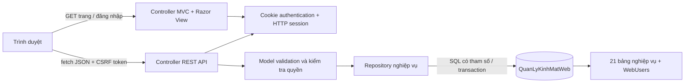
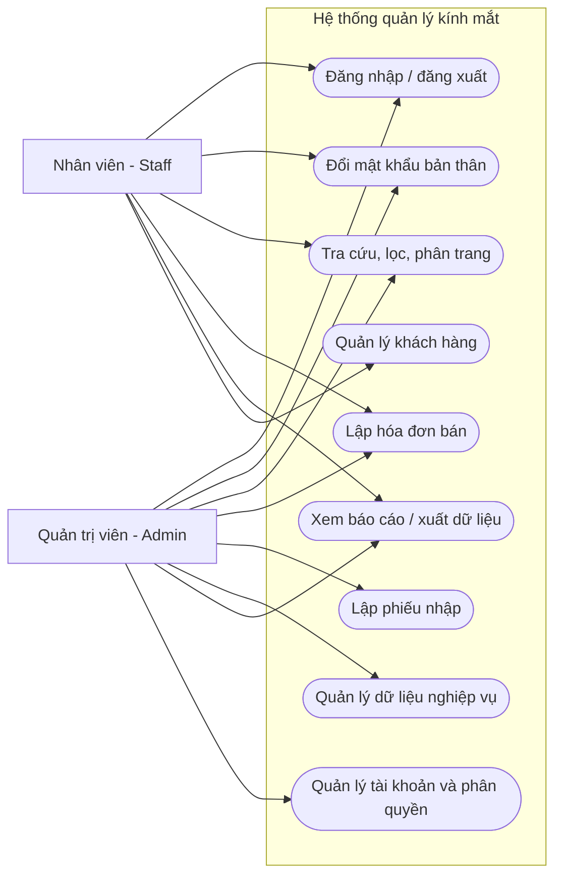

# Kiến trúc, use-case và thiết kế dữ liệu

## Phạm vi hệ thống

Ứng dụng phục vụ quản trị và nhân viên của cửa hàng kính mắt trên trình duyệt. Các nhóm chức năng gồm tổng quan, sản phẩm, khách hàng, nhà cung cấp, danh mục, nhập hàng, bán hàng, chứng từ, báo cáo và tài khoản.

Đây là ứng dụng ASP.NET Core MVC với Razor cho trang khung/đăng nhập và JavaScript gọi API bằng `fetch` cho các form nghiệp vụ. Dữ liệu lưu ở SQL Server qua `Microsoft.Data.SqlClient`; dùng SQL có tham số. EF là một hướng được dạy trong tài liệu tham khảo, không phải điều khoản bắt buộc riêng trong đề BTL.

Các thư mục chính:

| Thư mục | Trách nhiệm |
|---|---|
| `Controllers` | Nhận HTTP request, kiểm tra quyền, model và trả View/JSON/status code. |
| `Models` | DTO và input model có validation annotation; tách trường client được phép gửi khỏi entity tài khoản. |
| `Data` | Truy vấn SQL, ánh xạ dữ liệu, transaction chứng từ và tài khoản. |
| `Services` | Phát hành danh tính đăng nhập và dữ liệu HTTP session theo người dùng. |
| `Views` | Razor View trang đăng nhập và trang ứng dụng. |
| `wwwroot` | HTML/CSS/JavaScript và tài nguyên giao diện được trình duyệt tải. |
| `database`, `scripts` | Bộ khởi tạo database mới và dữ liệu đã loại mật khẩu cũ. |

## Các lớp người dùng và use-case

Vai trò `Admin` và `Staff` được lưu ở `WebUsers`, không suy ra từ tên hiển thị hoặc dữ liệu client. Quản lý người dùng là quyền của Admin; mỗi người đã đăng nhập được đổi mật khẩu của chính mình.

Bản nộp chỉ có ba tài khoản theo mã nhân viên `1`, `2`, `3`; mã `1` là Admin, hai mã còn lại là Staff. Hai tài khoản demo đã xóa và mã bootstrap đã gỡ. SQL khởi tạo chứa đủ ba PasswordHash nên máy cài mới không cần database WinForms gốc.

Chức năng quản trị thay đổi dữ liệu và chức năng nhân viên được xác định bằng thuộc tính `Authorize`/policy trên endpoint. Use-case biểu diễn quyền sử dụng; các quy tắc xóa chứng từ và dữ liệu có tham chiếu vẫn được repository kiểm tra.

Ma trận endpoint hiện tại:

| Resource / thao tác | Admin | Staff |
|---|---|---|
| GET `/api/products`, `/api/customers`, `/api/suppliers`, `/api/catalogs` | Có | Có |
| POST `/api/products`, PUT/DELETE `/api/products/{id}` | Có | Không |
| POST `/api/customers`, PUT/DELETE `/api/customers/{id}` | Có | Có |
| POST `/api/suppliers`, PUT/DELETE `/api/suppliers/{id}` | Có | Không |
| POST `/api/catalogs/{type}`, PUT/DELETE `/api/catalogs/{type}/{id}` | Có | Không |
| GET/POST `/api/sales`, GET `/api/sales/{id}` | Có | Có |
| POST `/api/sales/{id}/cancel` | Có | Không |
| GET/POST `/api/purchases`, GET `/api/purchases/{id}`, POST `/api/purchases/{id}/cancel` | Có | Không |
| GET/POST `/api/users`, PUT `/api/users/{id}` | Có | Không |
| POST `/api/account/password` cho tài khoản của chính mình | Có | Có |

Danh sách chính có GET theo ID tại sản phẩm, khách hàng và chứng từ. Hủy chứng từ là hành động POST có kiểm tra nghiệp vụ; không xóa lịch sử bằng DELETE. User được khóa qua cập nhật `IsActive`, giữ liên kết người lập chứng từ. Tài khoản mới tạo bằng POST; quyền và trạng thái được sửa bằng PUT. API trả 401 khi chưa đăng nhập, 403 khi không đủ quyền; validation trả 400, dữ liệu không tồn tại trả 404, xung đột nghiệp vụ có thể trả 409.

## ERD

Sơ đồ giữ tên bảng gốc để đối chiếu dump SQL. Chỉ liệt kê các trường khóa và trường quan trọng; định nghĩa SQL trong `../../QuanLyKinhMat.sql` là căn cứ đầy đủ về kiểu dữ liệu/ràng buộc.

```mermaid
erDiagram
  WebUsers {
    int Id PK
    int EmployeeId FK,UK
    nvarchar UserName UK
    nvarchar PasswordHash
    nvarchar Role
    bit IsActive
    uniqueidentifier SecurityStamp
  }
  NhanVien {
    int MaNhanVien PK
    nvarchar HoTen
    int MaChucVu FK
    bit TrangThai
  }
  TaiKhoan {
    int MaTaiKhoan PK
    int MaNhanVien FK
    varchar TenDangNhap UK
    bit TrangThai
  }
  ChucVu {
    int MaChucVu PK
    nvarchar TenChucVu
  }
  KhachHang {
    int MaKhachHang PK
    nvarchar HoTen
    varchar SoDienThoai
    nvarchar GhiChu
  }
  NhaCungCap {
    int MaNhaCungCap PK
    nvarchar TenNhaCungCap
  }
  SanPham {
    int MaSanPham PK
    nvarchar TenSanPham
    int MaLoai FK
    int MaThuongHieu FK
    decimal GiaNhap
    decimal GiaBan
    int SoLuongTon
    bit TrangThai
  }
  HoaDonBan {
    int MaHoaDon PK
    int MaKhachHang FK
    int MaNhanVien FK
    datetime NgayBan
    decimal TongTien
    uniqueidentifier TokenLuu UK
    bit DaHuy
  }
  ChiTietHoaDonBan {
    int MaHoaDon PK,FK
    int MaSanPham PK,FK
    int SoLuong
    decimal DonGiaBan
    decimal GiamGia
    decimal ThanhTienChot
  }
  PhieuNhap {
    int MaPhieuNhap PK
    int MaNhaCungCap FK
    int MaNhanVien FK
    datetime NgayNhap
    decimal TongTien
    uniqueidentifier TokenLuu UK
    bit DaHuy
  }
  ChiTietPhieuNhap {
    int MaPhieuNhap PK,FK
    int MaSanPham PK,FK
    int SoLuong
    decimal DonGiaNhap
    decimal GiamGia
    decimal ThanhTienChot
  }
  LoaiSanPham { int MaLoai PK }
  ThuongHieu { int MaThuongHieu PK }
  ChatLieu { int MaChatLieu PK }
  MauSac { int MaMauSac PK }
  LoaiGong { int MaLoaiGong PK }
  HinhDang { int MaHinhDang PK }
  Diop { int MaDiop PK }
  CongDung { int MaCongDung PK }
  DacDiem { int MaDacDiem PK }
  NuocSanXuat { int MaNuocSanXuat PK }
  BaoHanh { int MaBaoHanh PK }
  NhanVien ||--o| WebUsers : "tài khoản web"
  NhanVien ||--o{ TaiKhoan : "tài khoản cũ đã vô hiệu hóa"
  ChucVu o|--o{ NhanVien : "chức vụ nghiệp vụ"
  NhanVien ||--o{ HoaDonBan : "lập"
  NhanVien ||--o{ PhieuNhap : "lập"
  KhachHang ||--o{ HoaDonBan : "mua"
  NhaCungCap ||--o{ PhieuNhap : "cung cấp"
  HoaDonBan ||--|{ ChiTietHoaDonBan : "gồm"
  PhieuNhap ||--|{ ChiTietPhieuNhap : "gồm"
  SanPham ||--o{ ChiTietHoaDonBan : "được bán"
  SanPham ||--o{ ChiTietPhieuNhap : "được nhập"
  LoaiSanPham ||--o{ SanPham : "phân loại"
  ThuongHieu o|--o{ SanPham : "thương hiệu"
  ChatLieu o|--o{ SanPham : "chất liệu"
  MauSac o|--o{ SanPham : "màu sắc"
  LoaiGong o|--o{ SanPham : "loại gọng"
  HinhDang o|--o{ SanPham : "hình dáng"
  Diop o|--o{ SanPham : "độ kính"
  CongDung o|--o{ SanPham : "công dụng"
  DacDiem o|--o{ SanPham : "đặc điểm"
  NuocSanXuat o|--o{ SanPham : "xuất xứ"
  BaoHanh o|--o{ SanPham : "bảo hành"
```

`TokenLuu` có unique index có điều kiện `IS NOT NULL`, cho phép chứng từ cũ chưa có token nhưng ngăn lặp token của chứng từ mới. `EmployeeId` trong tài khoản web duy nhất, `UserName` duy nhất, vai trò giới hạn bởi check constraint. Công cụ chuyển tài khoản lấy mã nhân viên và mật khẩu từ SQL gốc một lần, lưu thành `WebUsers.PasswordHash`; web chỉ xác minh hash này. Bản SQL nguồn không bị sửa.

## Luồng lưu chứng từ

1. Người dùng chọn sản phẩm và số lượng trên form. Giá hiển thị là dữ liệu để xem trước, không phải nguồn quyết định giá tại máy chủ.
2. JavaScript gửi JSON, token chống gửi lặp và CSRF token tới API.
3. Máy chủ xác thực người dùng và quyền, kiểm tra annotation rồi kiểm tra sản phẩm/đối tác/quy tắc nghiệp vụ.
4. Repository mở transaction, đọc và khóa tồn kho, kiểm tra giá tại thời điểm lưu. Giá thay đổi phải báo người dùng kiểm tra lại.
5. Ghi đầu chứng từ, các dòng và cập nhật tồn trong cùng transaction. Cùng token không được tạo thêm chứng từ lần hai.
6. API trả kết quả; giao diện tải lại dữ liệu từ máy chủ và cập nhật lịch sử, tồn kho, báo cáo.

Người lập chứng từ được lấy từ danh tính đã xác thực trên server, không nhận mã nhân viên tùy ý từ JSON. Tiền tính bằng `decimal`, dùng đơn giá và giảm giá đã kiểm tra. Không tái dùng lớp Session static của WinForms cho danh tính các request.

## Security, session/cookies và quốc tế hóa

- Đăng nhập phát hành cookie xác thực; HTTP session lưu thông tin gắn với phiên người dùng. `SecurityStamp` hỗ trợ kiểm tra hiệu lực danh tính sau thay đổi tài khoản/mật khẩu.
- Mật khẩu lưu bằng `PasswordHasher`; API trả thông tin tài khoản công khai cần thiết, không trả hash.
- Kiểm tra quyền ở server; token chống CSRF cho các request thay đổi dữ liệu dùng cookie authentication.
- Input model dùng annotation như `Required`, `StringLength`, `Range`, `EmailAddress`, `Compare`; repository kiểm tra bổ sung các quan hệ và nghiệp vụ mà annotation không biểu diễn đủ.
- SQL dùng tham số cho dữ liệu nhập. Các tên bảng danh mục động phải đến từ danh sách cố định của ứng dụng.
- Giao diện xử lý lỗi bằng thông báo phù hợp; không hiển thị chuỗi kết nối hoặc thông tin nội bộ database cho người dùng.
- Quốc tế hóa được xem xét qua Unicode, định dạng ngày/tiền và văn hóa `vi-VN`. Chưa coi bản tiếng Việt là một bộ giao diện đa ngôn ngữ hoàn chỉnh; mở rộng thêm ngôn ngữ cần tách chuỗi giao diện thành resource và dịch nội dung/thông báo.

Ứng dụng được cấu hình cho máy cục bộ phục vụ học tập. Cookie Secure/HTTPS, chứng chỉ SQL, key lưu cookie, backup, quyền tài khoản SQL và vận hành nhiều máy là các phần cần cấu hình theo môi trường khi mở rộng triển khai; không suy diễn bản demo local đã đáp ứng triển khai công khai.

## Đối chiếu yêu cầu môn học

| Nội dung đề BTL | Vị trí trình bày/triển khai |
|---|---|
| ASP.NET MVC, các lớp người dùng | `Controllers`, `Views`, `Models`, vai trò Admin/Staff. |
| Template, responsive | Layout/Razor và CSS giao diện, kiểm thử desktop/mobile. |
| Paging, Filtering, AJAX | Form danh sách, tìm kiếm/lọc/phân trang, `fetch` tới API. |
| Thêm/sửa/xóa | API và repository dữ liệu nghiệp vụ; kiểm soát dữ liệu có tham chiếu. |
| Session, cookies, annotation | Đăng nhập, HTTP session, input model và model validation. |
| RESTFUL API/service | Resource URL và HTTP GET/POST/PUT/DELETE của các controller API. |
| Security, quốc tế hóa | Phần phân tích ở trên và các test xác thực/quyền/CSRF/validation. |
| Báo cáo, thiết kế, test, cài đặt/build DB | Tài liệu trong `docs`, README và bộ script database. |

Phải chạy các test case trước khi ghi nhận yêu cầu đã đạt trong báo cáo nộp; sự tồn tại của mã nguồn/tài liệu không thay thế kết quả chạy thực tế.
