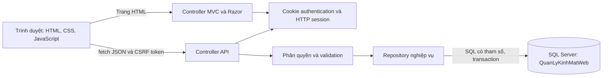
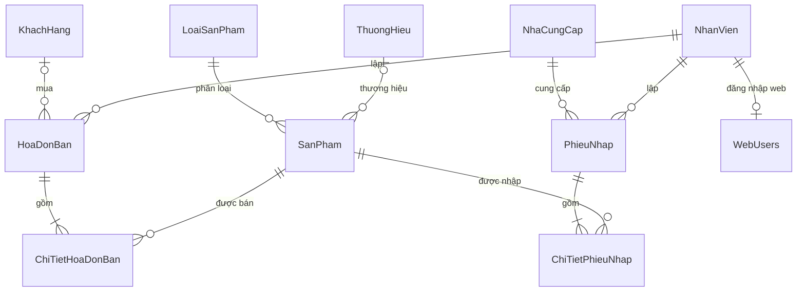
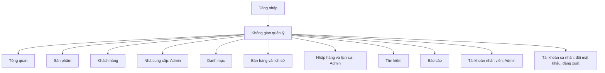
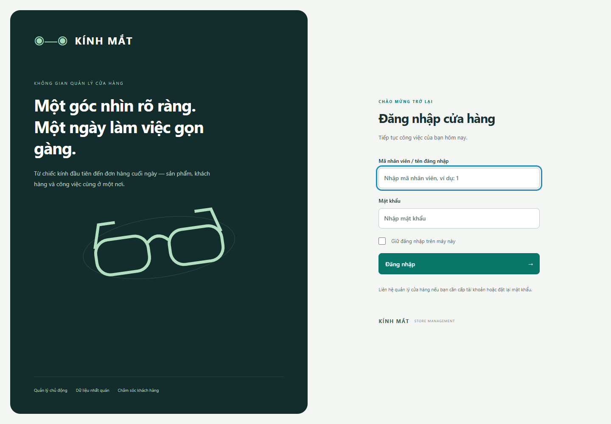
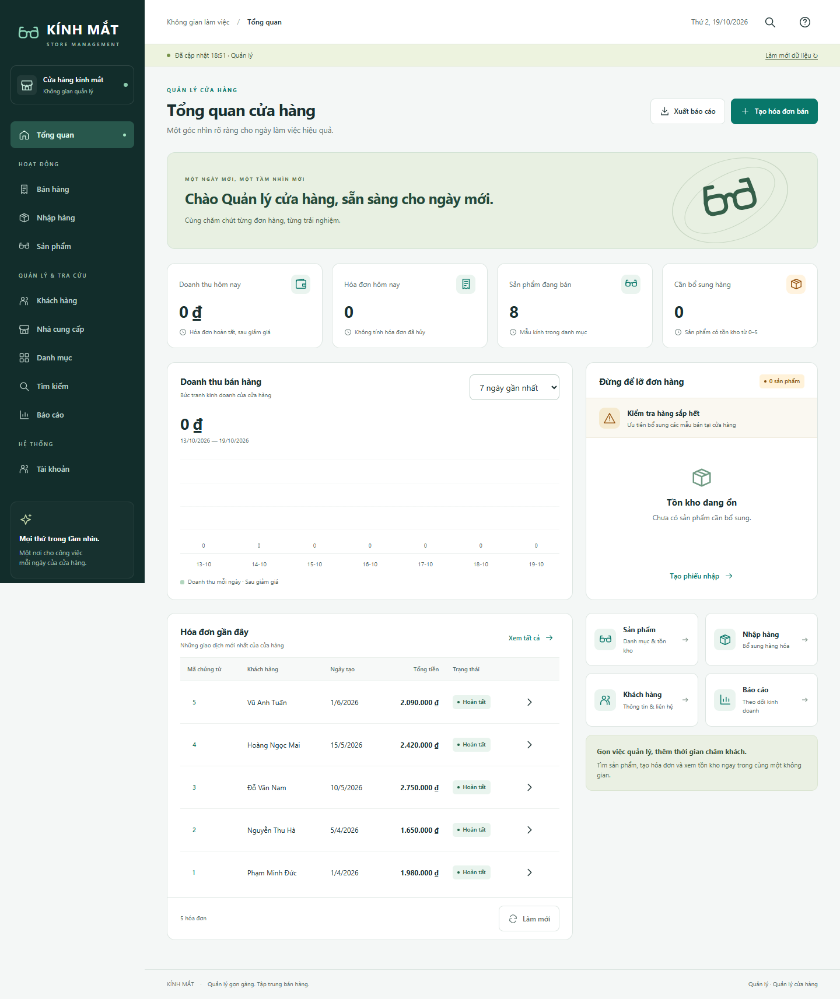
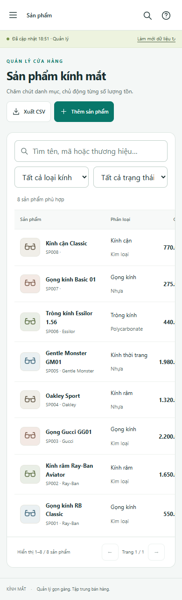

# Báo cáo bài tập lớn môn Lập trình web

**Đề tài: Xây dựng hệ thống quản lý cửa hàng kính mắt bằng ASP.NET Core MVC và SQL Server**

| Thông tin | Nội dung |
|---|---|
| Trường, khoa | [Cần bổ sung] |
| Lớp, mã học phần | [Cần bổ sung] |
| Giảng viên hướng dẫn | [Cần bổ sung] |
| Họ tên, mã sinh viên, nhóm thực hiện | [Cần bổ sung] |
| Phân công và thời gian thực hiện của nhóm | [Cần bổ sung] |
| Phiên bản kỹ thuật | `KinhMat.Web`, target `net10.0` |
| Ngày tổng hợp kiểm thử | 19/10/2026 |

Báo cáo mô tả ứng dụng web đã triển khai từ giao diện và dữ liệu nghiệp vụ được cung cấp. Hệ thống dùng ASP.NET Core MVC, Razor, JavaScript và SQL Server, có hai vai trò và database web riêng gồm 22 bảng. Kết quả thực tế gồm **186 kiểm tra đạt** và **40 tổ hợp kiểm tra bố cục** được ghi nhận riêng. Thông tin thành viên và khảo sát cửa hàng thực tế chỉ được xác nhận sau khi nhóm bổ sung.

## Mục lục

1. [Tổng quan về đề tài](#1-tổng-quan-về-đề-tài)
2. [Phân tích và thiết kế](#2-phân-tích-và-thiết-kế)
3. [Triển khai hệ thống](#3-triển-khai-hệ-thống)
4. [Kiểm thử và đánh giá](#4-kiểm-thử-và-đánh-giá)
5. [Kết luận và hướng phát triển](#5-kết-luận-và-hướng-phát-triển)

## 1. Tổng quan về đề tài

### 1.1. Bối cảnh và bài toán

Cửa hàng kính mắt cần quản lý sản phẩm, thuộc tính kính, giá nhập/bán, tồn kho, khách hàng, nhà cung cấp và chứng từ. Nhập hàng làm tăng tồn; bán hàng làm giảm tồn; hủy chứng từ phải điều chỉnh tồn theo chiều ngược lại. Nếu lưu từng bảng rời rạc hoặc chỉ kiểm tra tại giao diện, hệ thống có thể phát sinh tồn âm, tổng hóa đơn sai hoặc ghi cùng giao dịch nhiều lần.

Đầu vào của đề tài gồm hướng dẫn bài tập lớn, giao diện web và project quản lý kính mắt có dữ liệu SQL Server. Project cũ là WinForms, được dùng tham khảo nghiệp vụ và dữ liệu. Sản phẩm trong báo cáo là ứng dụng web có backend HTTP và database riêng, xử lý xác thực, phân quyền và giao dịch tại máy chủ.

Tên cửa hàng khảo sát, thời gian, phương pháp phỏng vấn và kết quả khảo sát thực tế: **[Cần bổ sung]**. Dữ liệu mẫu không được xem là bằng chứng khảo sát hoạt động kinh doanh thực tế.

### 1.2. Mục tiêu và phạm vi

Mục tiêu là hoàn thiện ứng dụng chạy trên máy học tập, có giao diện quản lý thống nhất và thực hiện được luồng khai báo dữ liệu → nhập hàng → bán hàng → xem chứng từ/báo cáo. Dữ liệu hiển thị sau khi lưu phải phản ánh kết quả máy chủ đã ghi; thao tác sai quyền hoặc sai nghiệp vụ phải bị từ chối tại backend.

Phạm vi gồm đăng nhập/đăng xuất, đổi mật khẩu, tổng quan, sản phẩm, khách hàng, nhà cung cấp, danh mục, nhập/bán/hủy chứng từ, tra cứu và xuất CSV. Ứng dụng phục vụ quản lý nội bộ. Bán trực tuyến cho khách, cổng thanh toán, giao vận và nhiều chi nhánh chưa nằm trong bản hiện tại.

### 1.3. Đối chiếu yêu cầu học phần

| Yêu cầu | Cách đáp ứng |
|---|---|
| ASP.NET MVC | ASP.NET Core MVC trên .NET 10; Controller tiếp nhận HTTP, Model chứa dữ liệu/ràng buộc, Razor View hiển thị đăng nhập và trang khung. |
| Các lớp người dùng | Hai vai trò `Admin`, `Staff`; kiểm tra quyền tại endpoint và hiển thị thao tác theo vai trò. |
| Template, responsive | Giữ phong cách giao diện đã chọn; sidebar, bảng, form, giỏ hàng thích ứng màn hình nhỏ. |
| Paging, filtering, AJAX | Sản phẩm phân trang 8 dòng, tìm kiếm và lọc loại/trạng thái tồn; gọi API bằng `fetch`. |
| CRUD | Thêm/sửa/xóa sản phẩm, khách hàng, nhà cung cấp và danh mục được hỗ trợ; bảo vệ dữ liệu có tham chiếu. |
| Session, cookies | Cookie đăng nhập, HTTP session, ghi nhớ đăng nhập và đăng xuất. |
| Annotation | `Required`, `StringLength`, `Range`, `RegularExpression`, `EmailAddress`, `Compare`. |
| REST API | Resource URL, GET/POST/PUT/DELETE, JSON và mã trạng thái HTTP. |
| Security | Hash mật khẩu, quyền máy chủ, CSRF, SQL có tham số, kiểm tra đầu vào và mã hóa đầu ra. |
| Quốc tế hóa | Unicode tiếng Việt, tiền/ngày `vi-VN`, tìm không dấu, CSV UTF-8 có BOM. |

Paging/filtering hiện xử lý trên danh sách đã tải về trình duyệt. Lựa chọn này phù hợp với bộ dữ liệu thực hành; khi dữ liệu lớn cần chuyển phân trang, lọc và tìm kiếm xuống truy vấn máy chủ.

### 1.4. Người sử dụng và phân quyền

| Chức năng | Admin | Staff |
|---|---|---|
| Đăng nhập, đăng xuất, đổi mật khẩu bản thân | Có | Có |
| Xem tổng quan, tra cứu sản phẩm/khách hàng/danh mục | Có | Có |
| Đọc dữ liệu nhà cung cấp qua API | Có | Có |
| Thêm/sửa/xóa khách hàng theo ràng buộc | Có | Có |
| Thay đổi sản phẩm, nhà cung cấp, danh mục | Có | Không |
| Lập/xem hóa đơn bán | Có | Có |
| Hủy hóa đơn bán | Có | Không |
| Lập/xem/hủy phiếu nhập | Có | Không |
| Xem báo cáo bán hàng, xuất dữ liệu theo quyền | Có | Có |
| Tạo tài khoản, đổi vai trò, khóa tài khoản | Có | Không |

Giao diện Staff không có màn hình nhập hàng và quản trị tài khoản. Các API vẫn kiểm tra `Authorize`: bỏ ẩn nút hoặc gửi request thủ công không làm tăng quyền. Người lập chứng từ được lấy từ danh tính đã xác thực, không nhận mã nhân viên tùy ý từ client.

### 1.5. Quy tắc nghiệp vụ

Sản phẩm có tên, loại hợp lệ, giá không âm và tồn kho nguyên từ 0 đến 1.000.000. Một dòng chứng từ có số lượng 1–10.000; một sản phẩm xuất hiện một lần trong chứng từ. Giảm giá nằm trong khoảng 0–100%; tiền và phần trăm được kiểm tra tối đa hai chữ số thập phân.

Thành tiền dòng bằng `số lượng × đơn giá × (100 − giảm giá) / 100`, làm tròn hai chữ số; tổng chứng từ là tổng các dòng. Bán chỉ dùng hàng đang kinh doanh, đủ tồn và giá hiện tại. Nhập cần nhà cung cấp; sau nhập, giá nhập tham khảo bằng đơn giá nhập vừa lưu, giá bán bằng 110% giá nhập.

Sản phẩm có chứng từ không được sửa tồn trực tiếp hoặc xóa làm mất lịch sử. Hủy bán hoàn tồn; hủy nhập trừ tồn và cập nhật giá theo phiếu còn hiệu lực mới nhất hoặc giá gốc đã lưu. Không hủy nhập nếu thiếu tồn để đảo giao dịch. Hủy lặp không đổi tồn lần hai; gửi lại cùng token/nội dung không tạo thêm chứng từ.

## 2. Phân tích và thiết kế

### 2.1. Kiến trúc tổng thể



Controller tiếp nhận và trả lời HTTP. Repository truy vấn SQL và thực hiện nghiệp vụ cần dữ liệu. Input model giới hạn trường client được gửi; DTO tài khoản không chứa hash/mật khẩu. Trang đăng nhập và khung dùng Razor; các màn hình nghiệp vụ dùng JavaScript theo hash và cập nhật nội dung bằng API. Database lưu lâu dài; giỏ chưa lưu nằm trong bộ nhớ trang và được giữ khi đổi màn hình trong cùng phiên trang.

### 2.2. Thiết kế cơ sở dữ liệu

Database web **`QuanLyKinhMatWeb`** tách khỏi database WinForms **`QuanLyKinhMat`**. Bộ schema được chuyển từ dump SQL đã cung cấp, giữ 21 bảng và thêm `WebUsers`, thành 22 bảng; bổ sung `KhachHang.GhiChu`. SQL đóng gói có ba tài khoản mã nhân viên bằng PasswordHash, không seed demo.

| Nhóm | Các bảng | Số lượng |
|---|---|---:|
| Sản phẩm và thuộc tính | `SanPham`, `LoaiSanPham`, `ThuongHieu`, `ChatLieu`, `MauSac`, `LoaiGong`, `HinhDang`, `Diop`, `CongDung`, `DacDiem`, `NuocSanXuat`, `BaoHanh` | 12 |
| Đối tác, nhân sự | `KhachHang`, `NhaCungCap`, `NhanVien`, `ChucVu` | 4 |
| Chứng từ | `HoaDonBan`, `ChiTietHoaDonBan`, `PhieuNhap`, `ChiTietPhieuNhap` | 4 |
| Tài khoản | `TaiKhoan`, `WebUsers` | 2 |
| **Tổng** | | **22** |



Đầu chứng từ lưu đối tác, người lập, ngày, tổng, mã, `TokenLuu`, trạng thái `DaHuy`. Chi tiết dùng khóa mã chứng từ–mã sản phẩm; lưu số lượng, đơn giá, giảm giá và `ThanhTienChot`. Giá/tiền dùng `decimal`; khóa ngoại bảo vệ quan hệ. Unique filtered index `TokenLuu IS NOT NULL` chống lặp chứng từ mới nhưng cho phép bản ghi cũ chưa có token.

`WebUsers` chứa mã tài khoản, `EmployeeId`, tên đăng nhập/hiển thị, hash, vai trò, trạng thái, `SecurityStamp`. Mã nhân viên và tên đăng nhập có ràng buộc duy nhất; vai trò giới hạn Admin/Staff. Seed web loại mật khẩu cũ trong `NhanVien`, vô hiệu hóa `TaiKhoan`; xác thực chỉ dùng `WebUsers.PasswordHash`.

Bổ sung theo dữ liệu đăng nhập thực tế: công cụ `Import-EmployeeLogins.ps1` chỉ đọc `NhanVien` gốc, đưa mã `1`/`2`/`3` và mật khẩu cũ sang `WebUsers` bằng PasswordHasher. Không sửa database gốc, không lưu lại mật khẩu văn bản trong bản web và không reset tài khoản khi chạy lại. Mã `1` là Admin, `2`/`3` là Staff. [employee-login-check.json](employee-login-check.json) ghi 26 kiểm tra đạt ở lượt mới cho đăng nhập/quyền/đăng xuất; hai tài khoản demo đã bị xóa, không tự tạo lại. SQL nộp kèm đủ ba hash nên không cần database gốc trên máy chấm bài.

Các bảng thuộc tính cũ được giữ bảo toàn dữ liệu; giao diện CRUD hiện hỗ trợ năm nhóm: loại kính, thương hiệu, chất liệu, màu sắc, hình dáng. ERD đầy đủ và kiểu dữ liệu nằm trong [architecture.md](architecture.md), [schema SQL](../../QuanLyKinhMatWeb.sql), [hướng dẫn database](database.md).

### 2.3. Use-case chính

| Use-case | Điều kiện và luồng chính | Luồng lỗi/kết quả |
|---|---|---|
| Đăng nhập | Tài khoản còn hoạt động; nhập → kiểm tra model/hash → cấp cookie/session | Sai thông tin hoặc đã khóa: thông báo chung, không cấp phiên hợp lệ. |
| Quản lý sản phẩm | Admin; mở form → nhập/sửa → kiểm tra thuộc tính → lưu → tải lại | Dữ liệu sai trả 400; trùng/tham chiếu gây xung đột; giữ lịch sử. |
| Nhập hàng | Admin, có nhà cung cấp; chọn sản phẩm/giá/SL → xác nhận → lưu đầu/chi tiết, tăng tồn | Một dòng sai làm từ chối toàn giao dịch; không ghi dở. |
| Bán hàng | Admin/Staff; chọn khách hoặc khách lẻ → thêm giỏ → kiểm tra giá/tồn → lưu | Giá thay đổi yêu cầu xem lại; thiếu tồn trả 409; lỗi mạng giữ giỏ. |
| Hủy chứng từ | Admin; xem chi tiết → xác nhận → kiểm tra khả năng đảo tồn → đánh dấu hủy | Thiếu tồn hủy nhập trả 409; hủy lặp không tác động lần hai. |
| Quản lý tài khoản | Admin; tạo/sửa quyền/trạng thái → lưu, đổi stamp | Staff bị chặn; bảo vệ Admin hoạt động cuối; khóa làm mất hiệu lực phiên. |

### 2.4. Sitemap và giao diện



Desktop chia thành sidebar, thanh trạng thái, nội dung và hộp thoại. Danh sách có tìm/lọc, số kết quả, phân trang; nhập/bán có sản phẩm bên cạnh giỏ và lịch sử bên dưới. Mobile dùng menu mở/đóng, form một cột, bảng cuộn trong khung. Hỗ trợ bàn phím qua skip link, focus nội dung, nhãn form, Escape đóng modal/trả focus và Enter gửi form. Các wireframe nằm trong [wireframes.md](wireframes.md).

## 3. Triển khai hệ thống

### 3.1. Công nghệ và mã nguồn

| Thành phần | Hiện thực |
|---|---|
| Backend | C#, ASP.NET Core MVC, target `net10.0` |
| View và tương tác | Razor, HTML/CSS responsive, JavaScript thuần, Fetch API |
| Database | SQL Server; Windows Authentication trên máy kiểm thử |
| Truy cập dữ liệu | `Microsoft.Data.SqlClient` 7.1.1, repository và SQL có tham số |
| Người dùng | Cookie Authentication, Claims, HTTP session, `PasswordHasher<WebUser>` |
| Kiểm thử | Node.js, Playwright, Edge, gọi API và đối chiếu SQL |

Mã được tách thành `Controllers`, `Models`, `Data`, `Services`, `Views`, `wwwroot`; các công cụ/tài liệu ở `database`, `scripts`, `docs`, `artifacts`. `StoreRepository` xử lý dữ liệu/chứng từ; `AccountRepository` xử lý tài khoản; `SqlDatabase` mở kết nối và kiểm tra đích; `SessionIssuer` cấp claims/cookie/session. Dự án dùng SqlClient trực tiếp, không dùng Entity Framework trong lớp truy cập dữ liệu.

### 3.2. Kết quả giao diện

Đăng nhập có tên người dùng, mật khẩu, ghi nhớ và thông báo validation. Sai người dùng và sai mật khẩu dùng thông báo chung, không tiết lộ riêng tài khoản có tồn tại.



Tổng quan hiển thị doanh thu/hóa đơn hôm nay, sản phẩm đang bán, hàng cần bổ sung, biểu đồ và chứng từ gần đây. Chỉ hóa đơn hoàn tất được tính doanh thu. Ngày dữ liệu mẫu là ngày lịch sử nên chỉ số hôm nay có thể bằng 0; ứng dụng không tự đổi ngày để tạo doanh thu.



Sản phẩm có CRUD theo quyền, ngừng bán, tìm tên/mã/thương hiệu, lọc loại/trạng thái tồn, phân trang 8 dòng và xuất CSV. Tìm “kinh doi anh” khớp tên “Kính Đổi Ánh”. Khách hàng/nhà cung cấp có tên, điện thoại, email, địa chỉ; khách có ghi chú. Form và API kiểm tra độc lập các giới hạn nhập.


Nhập/bán cho chọn đối tác, số lượng, giá/giảm giá và kiểm tra trước khi lưu. Lịch sử hiển thị chi tiết, trạng thái và thao tác hủy theo quyền. Báo cáo nhóm theo **mã sản phẩm**, tránh gộp hàng khác mã trùng tên. Admin quản lý tài khoản, vai trò, trạng thái; mỗi người đổi mật khẩu của mình. Mobile giữ dữ liệu bảng trong khung cuộn.



### 3.3. REST API và AJAX

| Resource | Phương thức/chức năng |
|---|---|
| `/api/products`, `/api/customers`, `/api/suppliers` | GET danh sách; POST tạo; PUT/DELETE theo ID theo quyền. |
| `/api/catalogs` và các URL `/{type}`, `/{type}/{id}` | Đọc danh mục, thêm/sửa/xóa năm loại được hỗ trợ. |
| `/api/sales`, `/api/sales/{id}`, `/api/sales/{id}/cancel` | Đọc/lập bán hàng, xem chi tiết, POST hủy của Admin. |
| `/api/purchases` và các URL tương ứng | Đọc/lập/hủy nhập hàng của Admin. |
| `/api/users`, `/api/users/{id}` | GET/POST/PUT tài khoản của Admin; khóa qua `IsActive`. |
| `/api/account/password` | POST đổi mật khẩu của người đang đăng nhập. |

GET theo ID có ở sản phẩm, khách hàng và chứng từ; không phải resource nào cũng có mọi biến thể. Tạo/cập nhật thành công trả 200/JSON, xóa trả 204. Các lỗi dùng 400 validation, 401 chưa xác thực, 403 thiếu quyền, 404 không có dữ liệu, 409 xung đột nghiệp vụ.

Ví dụ định dạng JSON cho `POST /api/sales` sau khi xác nhận giỏ:

```json
{
  "token": "d67fb68e-712e-45c2-a5dc-1dd47e5a61dd",
  "customerId": 1,
  "supplierId": null,
  "items": [
    { "productId": 1, "quantity": 2, "unitPrice": 550000, "discount": 10 }
  ]
}
```

Đây là ví dụ cấu trúc; giá/đối tác phải được kiểm tra tại thời điểm lưu. Request gửi cookie và `X-CSRF-TOKEN`; người lập lấy từ claims. Thành công trả chứng từ đã lưu, tải lại lịch sử/tồn và xóa giỏ. Thất bại hiện lỗi và giữ giỏ để sửa hoặc thử lại.

### 3.4. Transaction và tính đúng dữ liệu

Ghi chứng từ dùng transaction `Serializable` với `SET XACT_ABORT ON`. Kiểm tra token và tồn dùng `UPDLOCK,HOLDLOCK`, xử lý sản phẩm theo thứ tự mã; `sp_getapplock` theo nhóm chứng từ bảo vệ kiểm tra token/cấp mã trước các request đồng thời. Đầu chứng từ, chi tiết và tồn cùng commit hoặc rollback.

```mermaid
sequenceDiagram
  participant B as Trình duyệt
  participant A as API
  participant D as SQL Server
  B->>A: POST JSON + token + CSRF
  A->>A: Xác thực, quyền, validation
  A->>D: Transaction; kiểm tra token, khóa giá/tồn
  alt Dữ liệu hợp lệ
    A->>D: Ghi đầu, chi tiết, cập nhật tồn; Commit
    A-->>B: 200 + chứng từ đã lưu
  else Sai dữ liệu hoặc xung đột
    A->>D: Rollback
    A-->>B: 400/409 + thông báo; giữ giỏ
  end
```

Máy chủ tính tiền bằng `decimal`, làm tròn `AwayFromZero` hai chữ số. JavaScript dùng `BigInt` trên đơn vị nhỏ khi tính thành tiền dòng để phù hợp cách làm tròn. Luồng form thực tế đã kiểm tra `2 × 110.000 × 90% = 198.000đ`; bán giảm tồn 2, hủy hoàn lại 2.

Retry cùng token/nội dung trả chứng từ cũ, không trừ tồn thêm; đổi nội dung với token cũ bị từ chối. Nếu người mua trước làm hết hàng, giao dịch sau bị từ chối toàn bộ. Hủy giữ lịch sử và kiểm tra khả năng đảo tồn/giá, không xóa hóa đơn đã lưu.

### 3.5. Session, cookies và annotation

Cookie `KinhMat.Auth` chứa vé xác thực do ASP.NET bảo vệ, có `HttpOnly`, `SameSite=Lax`. Đăng nhập thường có thời hạn 8 giờ; ghi nhớ tạo cookie persistent với thời hạn 14 ngày. `KinhMat.Session` gắn với HTTP session lưu mã/tên nhân viên, idle timeout 8 giờ; bản local lưu session trong bộ nhớ tiến trình.

Trạng thái tài khoản và `SecurityStamp` được kiểm tra khi xác thực cookie. Đổi mật khẩu cấp lại danh tính cho phiên thực hiện, làm cookie stamp cũ ở phiên khác mất hiệu lực. Khóa hoặc thay đổi quyền cũng làm cookie cũ không tiếp tục được tin cậy. Đăng xuất clear session/sign-out cookie; URL quay lại chỉ chấp nhận địa chỉ cục bộ.

Annotation kiểm tra tên sản phẩm bắt buộc/tối đa 150 ký tự, giá/tồn trong khoảng, email, điện thoại có 8–15 chữ số trong định dạng cho phép, mật khẩu mới ít nhất 8 ký tự và `Compare` mật khẩu xác nhận. Repository kiểm tra những điều kiện cần dữ liệu như danh mục tồn tại, đủ tồn, tham chiếu và Admin hoạt động cuối cùng.

### 3.6. Security và quốc tế hóa

| Rủi ro/nội dung | Cơ chế hiện có |
|---|---|
| Mật khẩu | `PasswordHasher<WebUser>`; không trả hash qua DTO; loại mật khẩu cũ khỏi seed web. |
| Sai quyền | `Authorize` phía server; Staff không tự nâng quyền hoặc sửa người khác. |
| CSRF | `AutoValidateAntiforgeryToken`, token header `X-CSRF-TOKEN`; thiếu/sai token bị từ chối. |
| SQL injection | Tham số hóa giá trị; tên bảng/cột động lấy từ ánh xạ cố định. |
| HTML/script injection | Escape chuỗi trước khi chèn HTML; tên có thẻ, dấu nháy, mã SQL được xử lý như dữ liệu. |
| Bảo vệ trình duyệt | CSP với nonce cho script, `nosniff`, chặn nhúng frame, giới hạn kết nối; trang/API không cache dữ liệu. |
| Thử đăng nhập lặp | POST đăng nhập có limiter 12 request/một phút theo cấu hình hiện tại. |
| Lỗi nội bộ | Log phía máy chủ; thông báo cho người dùng không chứa connection string/stack SQL. |
| Tranh chấp dữ liệu | Transaction, khóa và token chống lặp; kiểm tra giá/tồn tại thời điểm lưu. |

Tên/mô tả lưu Unicode; giao diện dùng tiếng Việt, chuẩn hóa dấu để tìm kiếm và `Intl.NumberFormat('vi-VN')` để hiển thị tiền/số. Ngày trên giao diện theo `vi-VN`; CSV giữ ngày `YYYY-MM-DD`, UTF-8 BOM, dấu nháy được thoát và số thập phân được bảo toàn. Ô có tiền tố công thức được thêm dấu nháy đơn khi xuất.

Hiện chỉ có giao diện tiếng Việt; chưa có bộ chọn nhiều ngôn ngữ. Mở rộng cần resource cho chuỗi, dịch validation và thống nhất culture/timezone giữa server, trình duyệt và database.

### 3.7. Cài đặt và bản bàn giao

Máy kiểm thử dùng SQL Server `HIEUCOI\SQLEXPRESS`, Windows Authentication. `CHAY-WEB.cmd` kiểm tra/tạo database riêng nếu chưa có, build mã nguồn khi chưa có runtime cục bộ và mở `http://127.0.0.1:5080`; `TAT-WEB.cmd` dừng đúng tiến trình launcher quản lý. Cách chạy mã nguồn bằng SDK/cấu hình instance nằm trong [README](../README.md).

Khởi tạo dừng trước khi ghi nếu database web đã tồn tại; từng batch kiểm tra database đích và dấu session runner. `SqlDatabase` chỉ chấp nhận tên `QuanLyKinhMatWeb`. Release build đạt 0 lỗi/0 cảnh báo; bản publish/launcher và gói giải nén tại thư mục khác có khoảng trắng đã được chạy theo [verification.md](verification.md).

## 4. Kiểm thử và đánh giá

### 4.1. Môi trường và phương pháp

Kiểm thử trên Windows, .NET SDK 10.0.401, ASP.NET Core 10.0.12, Edge, SQL Server và database `QuanLyKinhMatWeb`. Playwright kiểm tra API và form, đọc lại dữ liệu để đối chiếu tồn, tổng, trạng thái phiên. Fixture có mã QA và ID/token ghi ngay vào JSON; dọn đúng dữ liệu đã theo dõi, không xóa rộng theo tên. Chứng từ thật được hủy theo nghiệp vụ trước khi dọn.

### 4.2. Tổng hợp kiểm tra thực tế

| Bộ | Đạt / đã chạy | Bằng chứng lượt hoàn tất |
|---|---:|---|
| API/nghiệp vụ chính | 55 / 55 | [test-results.json](test-results.json): API và nghiệp vụ |
| CRUD, tài khoản, bán/hủy qua form | 29 / 29 | [test-results.json](test-results.json): Form quản lý và bán hàng |
| Hồi quy báo cáo theo mã sản phẩm | 2 / 2 | [test-results.json](test-results.json): Hồi quy báo cáo |
| Validation, nhập/hủy nhiều dòng mở rộng | 28 / 28 | [test-results.json](test-results.json): Form nhập hàng và validation |
| Auth, quyền, CSRF, hiệu lực phiên mở rộng | 45 / 45 | [test-results.json](test-results.json): Đăng nhập, phân quyền và CSRF |
| Tìm/lọc/phân trang, keyboard, mạng, CSV | 27 / 27 | [test-results.json](test-results.json): Tìm kiếm, bàn phím, CSV và lỗi mạng |
| **Tổng** | **186 / 186** | Không cộng các lượt dở hoặc kiểm tra lặp trước đó. |

Ngoài 186 kiểm tra, **40/40 tổ hợp bố cục** của 10 màn hình tại 320, 390, 768, 1440px đạt, không tràn toàn trang; dữ liệu ở [preview-check.json](screenshots/preview-check.json). Tệp còn ghi nhận không có page error, đăng xuất và validation tiếng Việt. Các kiểm tra bố cục không cộng thêm vào 186. Danh mục điều kiện/đầu vào/đầu ra nằm trong [test-cases.md](test-cases.md), mô tả kết quả trong [verification.md](verification.md).

186 là số kiểm tra/assertion trong các bộ thực thi, không đồng nghĩa 186 ca nghiệp vụ độc lập hoặc đã bao phủ mọi trạng thái có thể xảy ra.

Bổ sung cho bộ nộp mới: sau khi xóa demo, bộ nghiệp vụ 55/55 đã chạy lại bằng mã nhân viên 1; bộ đăng nhập 26/26 xác nhận chỉ còn ba tài khoản, hai tên demo bị từ chối và quyền đúng. Các bộ khác trong bảng tổng hợp giữ bằng chứng lịch sử ở lượt trước; xem [submission-check.json](submission-check.json).

### 4.3. Các kết quả quan trọng

| Tình huống | Kết quả |
|---|---|
| Hai người mua đơn vị tồn cuối | Một request thành công, một request 409; không tồn âm. |
| Cùng token gửi lại/đồng thời | Một chứng từ, một lần cập nhật tồn; nội dung khác dùng token cũ bị từ chối. |
| Một dòng thiếu tồn trong chứng từ nhiều dòng | Rollback toàn bộ, không ghi dở các dòng còn lại. |
| Giá cũ hoặc thay đổi trước xác nhận | API từ chối giá sai; giỏ cập nhật và yêu cầu xác nhận lại. |
| Nhập nhiều dòng có giá/giảm giá thập phân | Tổng đúng quy tắc, tồn tăng đúng; hủy khôi phục số lượng/giá, hủy lặp không đổi lần hai. |
| Hủy nhập khi hàng đã dùng hết | 409, không tạo tồn âm. |
| Tên rỗng/quá dài, tiền/tồn sai, dòng trùng/null | Từ chối, không chèn dữ liệu lỗi. |
| Staff tự nâng quyền/sửa người khác | Từ chối, dữ liệu tài khoản không đổi. |
| POST/PUT/DELETE thiếu/sai CSRF | Từ chối, dữ liệu không đổi. |
| Đổi mật khẩu, nhiều phiên và khóa | Phiên đổi mật khẩu còn hợp lệ; cookie cũ mất hiệu lực; mật khẩu cũ/đúng nhưng tài khoản khóa không đăng nhập được. |
| Search không dấu, lọc, trang 8 dòng | Đúng tập QA, trang cuối không lặp; đổi query về trang một. |
| HTML/dấu nháy/chuỗi SQL trong tên | Lưu/hiển thị nguyên dữ liệu; không thực thi script. |
| Keyboard | Skip giữ route, Escape đóng/trả focus, Enter gửi form hợp lệ. |
| Mô phỏng mất mạng POST bán | Lỗi có focus; giữ khách/SL/tổng; không có hóa đơn mới hay đổi tồn; bỏ mô phỏng xác nhận lại được. |
| CSV | BOM, Unicode, dấu phẩy/nháy, tiền thập phân và ngày đúng định dạng. |

Ca CSV hóa đơn có ngày/thập phân cố định trong bộ UI dùng **phản hồi GET giả lập tại trình duyệt**, ghi rõ `mockedResponses`; không tạo hóa đơn SQL. Các ca lưu/hủy chứng từ thật nằm ở bộ API/form và có token/đối chiếu database. Giả lập lỗi mạng chặn POST trước khi đến backend.

### 4.4. Sai sót đã xử lý

| Vấn đề | Cách khắc phục và kết quả kiểm tra lại |
|---|---|
| Tràn chiều ngang trên mobile | Đặt vùng bảng và nhãn hỗ trợ trong khung phù hợp; 40 tổ hợp bố cục đạt. |
| Xác nhận giá cũ nhưng lưu giá khác | Nạp lại giá/tồn trước xác nhận, cập nhật giỏ, kiểm tra lại trong transaction; giá cũ trả 409. |
| Báo cáo gộp hàng trùng tên | Nhóm theo ID; hai mã cùng tên tách nhóm, một mã đổi tên vẫn một nhóm. |
| Điện thoại không chứa số | Siết annotation/server; `--------` trả 400. |
| Cookie cũ sau đổi tài khoản/mật khẩu | Kiểm tra trạng thái/stamp và cấp lại danh tính đúng; thử nhiều context xác nhận thu hồi cookie cũ. |

Kiểm tra DB gốc theo [original-database-check.json](original-database-check.json) chụp schema và SHA-256 của 22 bảng trước/sau một vòng nhập hai dòng, hủy và dọn QA; dữ liệu so sánh giữ nguyên. Baseline này được tạo cho vòng kiểm thử đó, không có baseline trước lần khởi tạo web đầu tiên để chứng minh hồi tố toàn bộ quá trình.

### 4.5. Đánh giá và giới hạn

[database-final-check.json](database-final-check.json) ghi nhận sau khi dọn QA và chuyển tài khoản cũ: 8 sản phẩm, 5 khách, 3 nhà cung cấp, 5 hóa đơn, 3 phiếu nhập, 3 tài khoản web theo mã nhân viên; tồn âm, mật khẩu nhân viên cũ trong cột Passw của bản web và tổng hóa đơn lệch chi tiết đều bằng 0. Chứng từ nguồn chưa có `ThanhTienChot` dùng công thức số lượng × đơn giá × phần trăm sau giảm, làm tròn hai chữ số khi đối chiếu. Đây là số liệu tại thời điểm ghi trong tệp.

Chưa chạy kiểm thử tải lớn, HTTPS công khai, nhiều máy chủ, mất điện giữa giao dịch hoặc đánh giá người dùng tại cửa hàng. Hai request tranh mua kiểm tra một tình huống đồng thời cụ thể, chưa phải benchmark. Limiter đăng nhập có trong mã nhưng bộ auth chủ động giữ request dưới ngưỡng; không khẳng định đã thử áp lực vượt giới hạn.

## 5. Kết luận và hướng phát triển

### 5.1. Kết quả đạt được

Ứng dụng đã có backend ASP.NET Core MVC và SQL Server thực, giữ phong cách giao diện được chọn, hoàn thiện đăng nhập/quyền, CRUD, nhập/bán/hủy, tra cứu và báo cáo. Database web riêng 22 bảng giữ liên hệ dữ liệu nguồn và bổ sung tài khoản hash. Yêu cầu MVC, lớp người dùng, responsive, paging/filtering/AJAX, session/cookies, annotation, REST, security/i18n có vị trí triển khai cụ thể.

186 kiểm tra đạt và 40 tổ hợp bố cục cung cấp bằng chứng cho các luồng đã chạy. Sự tách lớp HTTP, model, repository và SQL giúp kiểm soát đầu vào, quyền và giao dịch rõ ràng; tính đúng của tồn và tổng cần được bảo vệ ở máy chủ, ngay cả khi giao diện đã kiểm tra trước.

### 5.2. Hạn chế

Bản hiện tại dành cho học tập local: danh sách tải toàn bộ, session trong bộ nhớ, giao diện chỉ tiếng Việt, một số bảng thuộc tính chưa có CRUD riêng. Khóa chứng từ ưu tiên tính đúng và chưa đo hiệu năng ở quy mô lớn. Bản loopback dùng HTTP và cấu hình tin cậy chứng chỉ SQL phục vụ thực hành.

Khảo sát, phân công và kết quả sử dụng ở cửa hàng phải do nhóm bổ sung. Không thay các nội dung đó bằng dữ liệu mẫu hay số liệu giả định; cũng không suy từ việc có mã bảo mật sang kết luận đã đạt yêu cầu triển khai công khai.

### 5.3. Hướng phát triển

Ưu tiên chuyển tìm/lọc/phân trang xuống server, mở rộng báo cáo theo khoảng ngày và kiểm thử backup/restore. Khi có yêu cầu thực tế, có thể thêm nhiều chi nhánh, kho và nhật ký thao tác.

Để chạy nhiều người dùng cần cấu hình HTTPS/chứng chỉ SQL, quyền SQL tối thiểu, kho session/khóa dùng chung, giám sát, load test và diễn tập phục hồi. Quốc tế hóa cần resource, bản dịch và quy tắc culture/timezone nhất quán. Thanh toán trực tuyến và chức năng khách hàng cần phạm vi, thiết kế và kiểm thử riêng.

### 5.4. Tài liệu và sản phẩm bàn giao

| Thành phần | Tài liệu/vị trí |
|---|---|
| Cài đặt, cấu hình, chạy và xử lý lỗi | [README](../README.md) |
| Kiến trúc, use-case, ERD | [architecture.md](architecture.md) |
| Sitemap và wireframe | [wireframes.md](wireframes.md) |
| Danh mục test và kết quả thực tế | [test-cases.md](test-cases.md), [verification.md](verification.md), [test-results.json](test-results.json) |
| Schema, dữ liệu và quy tắc khởi tạo | [Hướng dẫn database](database.md), [SQL](../../QuanLyKinhMatWeb.sql) |
| Ảnh chạy thực tế | `docs/screenshots/` |
| Mã nguồn | [QuanLyKinhMatWeb.csproj](../QuanLyKinhMatWeb.csproj), `Controllers`, `Models`, `Data`, `Services`, `Views`, `wwwroot` |
| Công cụ và bản chạy | `CHAY-WEB.cmd`, `TAT-WEB.cmd`, `scripts/` (bản Git build từ source) |

Cơ sở báo cáo là hướng dẫn học phần đã cung cấp, mã nguồn, schema và artifact kiểm thử. Những vị trí **[Cần bổ sung]** dành cho thông tin cá nhân/nhóm và khảo sát thực tế cần được hoàn thiện trước khi nộp.
