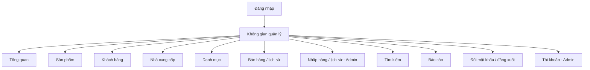

# Sitemap và wireframe giao diện

Các khung dưới đây mô tả bố cục chức năng của giao diện; màu, biểu tượng và dữ liệu cụ thể được thể hiện trong ảnh chụp sản phẩm chạy thực tế. Những nút chỉ dành cho Admin được ẩn ở phiên Staff, đồng thời endpoint vẫn kiểm tra quyền.

## Sitemap



## Đăng nhập

```text
+------------------------------------------------------+
|             QUẢN LÝ CỬA HÀNG KÍNH MẮT                |
|             Mô tả ngắn về không gian quản lý         |
|                                                      |
|      +----------------------------------------+      |
|      | Tên đăng nhập                          |      |
|      | [....................................] |      |
|      | Mật khẩu                               |      |
|      | [....................................] |      |
|      | [ ] Ghi nhớ đăng nhập                  |      |
|      | Thông báo lỗi khi đăng nhập thất bại   |      |
|      |             [ Đăng nhập ]              |      |
|      +----------------------------------------+      |
+------------------------------------------------------+
```

## Danh sách sản phẩm - desktop

```text
+------------------+--------------------------------------------------+
| Logo / cửa hàng  | Breadcrumb                    Tài khoản / thao tác |
|                  +--------------------------------------------------+
| Tổng quan        | SẢN PHẨM                         [Xuất] [+ Thêm] |
| Sản phẩm         | Mô tả trang                                      |
| Khách hàng       |                                                  |
| Nhà cung cấp     | [Tìm tên / mã...] [Loại kính v] [Trạng thái v]   |
| Danh mục         | +----------------------------------------------+ |
| Bán hàng         | | Mã | Tên | Loại | Giá | Tồn | Trạng thái | Sửa| |
| Nhập hàng        | | ...                                          | |
| Tìm kiếm         | | ...                                          | |
| Báo cáo          | +----------------------------------------------+ |
| Tài khoản        | Hiển thị kết quả                 [<] [1] [2] [>] |
|                  | Thông báo trạng thái hoặc lỗi                     |
+------------------+--------------------------------------------------+
```

## Form thêm/sửa dữ liệu

```text
+------------------------------------------------------+
| Tiêu đề: Thêm / Sửa sản phẩm                    [X] |
|------------------------------------------------------|
| Thông báo lỗi tổng quát (nếu có)                     |
| Tên sản phẩm *                                      |
| [.................................................] |
| Loại kính *                 Thương hiệu              |
| [..................... v]  [..................... v] |
| Giá bán *                   Giá nhập                |
| [.......................]  [.......................] |
| Tồn ban đầu                 Trạng thái              |
| [.......................]  [..................... v] |
| Các thuộc tính / mô tả                              |
| [.................................................] |
| Hướng dẫn và lỗi tại trường                         |
|                                  [Hủy] [Lưu dữ liệu] |
+------------------------------------------------------+
```

Form khách hàng/nhà cung cấp/tài khoản theo cùng cấu trúc: nhãn rõ ràng, dấu bắt buộc, vùng lỗi, nút hủy và lưu. Form trên mobile chuyển các cặp trường sang một cột. Không cho sửa trực tiếp tồn của sản phẩm đã có chứng từ; dùng nhập/bán và hủy theo quy tắc.

## Bán hàng / nhập hàng

```text
+-----------------------------+------------------------------+
| CHỌN SẢN PHẨM               | HÓA ĐƠN / PHIẾU NHẬP        |
| [Tìm sản phẩm............]  | [Khách hàng / NCC........v] |
|                             |                              |
| [Sản phẩm] [Sản phẩm]       | Sản phẩm A       [SL] [Bỏ] |
| [Sản phẩm] [Sản phẩm]       | Giá / giảm giá / thành tiền |
| [Sản phẩm] [Sản phẩm]       | Sản phẩm B       [SL] [Bỏ] |
|                             |                              |
|                             | Số lượng / Tổng tiền         |
|                             | [Kiểm tra và xác nhận]       |
+-----------------------------+------------------------------+
| LỊCH SỬ CHỨNG TỪ                                           |
| Mã | Ngày | Đối tác | Người lập | Tổng tiền | Trạng thái    |
| Chọn chứng từ để xem chi tiết / hủy theo quyền              |
+------------------------------------------------------------+
```

## Mobile

```text
+------------------------------+
| [Menu]  Tên trang  [Tài khoản]|
|------------------------------|
| Tiêu đề và mô tả              |
| [Thao tác chính]             |
| [Tìm kiếm..................] |
| [Bộ lọc.................. v] |
| [Bộ lọc.................. v] |
| +--------------------------+ |
| | Bảng trong khung cuộn     | |
| | hoặc các thẻ dữ liệu      | |
| +--------------------------+ |
| [<] [1] [2] [>]              |
| Thông báo kết quả             |
+------------------------------+
```

Menu mở thành lớp điều hướng; vùng chính giữ thao tác truy cập được. Khi kiểm tra responsive cần phân biệt cuộn của bảng trong khung với cuộn tràn cả trang; xem thêm test `UI01` trong `test-cases.md`.
