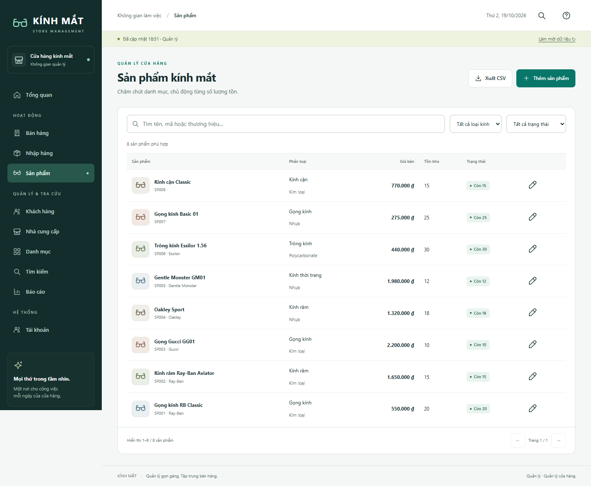

# WebQuanLyKinhMat

Ứng dụng quản lý cửa hàng kính mắt phục vụ bài tập lớn môn Lập trình web. Hệ thống hỗ trợ quản lý hàng hóa, nhập hàng, bán hàng, tồn kho và doanh thu, xây dựng bằng **ASP.NET Core MVC (.NET 10)** và **SQL Server**.

Đây là ứng dụng dành cho quản lý và nhân viên cửa hàng. Mã nguồn, solution, bộ SQL và tài liệu được đặt chung trong repository để thuận tiện mở, chạy và nộp bài.

**Bắt đầu tại:** [Cài đặt và sử dụng](CAI_DAT_VA_SU_DUNG.md) · [Báo cáo kỹ thuật](WebQuanLyKinhMat/docs/report.md) · [Kiến trúc hệ thống](WebQuanLyKinhMat/docs/architecture.md)



## Chức năng chính

| Nhóm chức năng | Nội dung |
|---|---|
| Tài khoản | Đăng nhập, đăng xuất, đổi mật khẩu cá nhân; quản lý tài khoản theo quyền. |
| Sản phẩm và danh mục | Quản lý sản phẩm, loại sản phẩm, thương hiệu, chất liệu, màu sắc và hình dáng; tìm kiếm, lọc và phân trang. |
| Khách hàng, nhà cung cấp | Lưu thông tin liên hệ, tra cứu và cập nhật dữ liệu theo quyền. |
| Bán hàng | Chọn sản phẩm, số lượng, giảm giá và khách hàng; lập, xem và hủy hóa đơn theo quyền. |
| Nhập hàng | Chọn nhà cung cấp, nhập sản phẩm; lập, xem và hủy phiếu nhập, cập nhật giá và tồn kho. |
| Thống kê | Tổng quan, doanh thu 7 hoặc 30 ngày gần nhất, sản phẩm bán chạy và xuất dữ liệu CSV. |

### Phân quyền

Quyền được kiểm tra tại máy chủ, đồng thời quyết định các mục hiển thị trên giao diện.

| Thao tác | Quản lý (`Admin`) | Nhân viên (`Staff`) |
|---|:---:|:---:|
| Xem tổng quan, báo cáo, sản phẩm và danh mục | Có | Có |
| Thêm, sửa, xóa sản phẩm và danh mục | Có | Không |
| Quản lý nhà cung cấp | Có | Không có màn hình quản lý |
| Thêm, sửa, xóa khách hàng | Có | Có |
| Lập và xem hóa đơn bán | Có | Có |
| Hủy hóa đơn bán | Có | Không |
| Xem, lập và hủy phiếu nhập | Có | Không |
| Quản lý tài khoản | Có | Không |
| Đổi mật khẩu của bản thân, đăng xuất | Có | Có |

Nhân viên có thể đọc dữ liệu nhà cung cấp qua API; thao tác quản lý và màn hình nhà cung cấp dành cho quản lý. Hai tài khoản nhân viên trong bộ dữ liệu dùng chung quyền `Staff`, chưa tách riêng quyền bán hàng và quyền kho.

## Công nghệ và tổ chức mã nguồn

| Thành phần | Công nghệ |
|---|---|
| Máy chủ | C#, ASP.NET Core MVC, Razor, .NET 10 |
| Truy cập dữ liệu | ADO.NET qua `Microsoft.Data.SqlClient`, SQL có tham số |
| Giao diện | HTML, CSS, JavaScript; gọi API bằng `fetch` |
| Cơ sở dữ liệu | SQL Server; khởi tạo bằng script PowerShell và bộ SQL đi kèm |
| Xác thực | Cookie, hai vai trò `Admin`/`Staff`, mật khẩu băm bằng ASP.NET Core PasswordHasher |

Repository chứa mã nguồn; cần **.NET 10 SDK** để biên dịch. Không cần cài Node.js để chạy ứng dụng thông thường.

```text
WebQuanLyKinhMat/                  # Thư mục repository
├── WebQuanLyKinhMat/              # Project ASP.NET Core MVC
│   ├── Controllers/               # Trang MVC và API
│   ├── Data/, Models/, Services/  # Dữ liệu, mô hình và nghiệp vụ
│   ├── Views/, wwwroot/           # Razor, CSS, JavaScript và tài nguyên
│   ├── Properties/               # Cấu hình chạy trong IDE
│   ├── scripts/, tests/, docs/    # Script, kiểm thử và tài liệu kỹ thuật
│   ├── appsettings.json
│   ├── CHAY-WEB.cmd
│   ├── TAT-WEB.cmd
│   └── WebQuanLyKinhMat.csproj
├── .gitignore
├── CAI_DAT_VA_SU_DUNG.md
├── QuanLyKinhMat.sql
├── WebQuanLyKinhMat.slnx
└── README.md
```

Mở **`WebQuanLyKinhMat.slnx` ở ngoài cùng** để làm việc trong Visual Studio. Hai thư mục cùng tên là có chủ đích: thư mục ngoài chứa bộ nộp, thư mục trong chứa project.

## Chạy nhanh trên Windows

1. Cài **.NET 10 SDK** và **SQL Server**; cần truy cập nguồn NuGet cho lần khôi phục thư viện đầu tiên nếu máy chưa có cache.
2. Trong `WebQuanLyKinhMat/appsettings.json`, đổi `Server` thành tên SQL Server/instance của máy. Mặc định là `HIEUCOI\SQLEXPRESS`, sử dụng Windows Authentication. Giữ `Database=QuanLyKinhMatWeb`. Có thể dùng file `appsettings.Local.json` riêng theo [hướng dẫn cài đặt](CAI_DAT_VA_SU_DUNG.md).
3. Vào thư mục project bên trong, nhấp đúp **`CHAY-WEB.cmd`**. Script kiểm tra database, khởi tạo nếu chưa có, biên dịch mã nguồn và mở trình duyệt tại [http://127.0.0.1:5080](http://127.0.0.1:5080).
4. Đăng nhập bằng một tài khoản trong bảng dưới. Khi dùng xong, chạy **`TAT-WEB.cmd`** trong cùng thư mục project.

**Lần đầu chạy:** tài khoản Windows kết nối SQL Server cần quyền tạo database. Bộ khởi tạo dùng file `QuanLyKinhMat.sql` ở ngoài cùng và dừng nếu database đã tồn tại; không ghi đè dữ liệu đang dùng. Máy mới không cần có database WinForms gốc.

**Chạy bằng Visual Studio hoặc `dotnet run`:** phải khởi tạo database trước bằng script hoặc chạy nhanh một lần. Hai cách này không tự tạo database. Các lệnh và cách dừng tương ứng có trong [Cài đặt và sử dụng](CAI_DAT_VA_SU_DUNG.md).

### Tài khoản trong bộ dữ liệu

| Tên đăng nhập | Quyền trên web | Mật khẩu khởi tạo |
|---|---|---|
| `1` | Quản lý (`Admin`) | `hieucoi12345` |
| `2` | Nhân viên (`Staff`) | `hieucoi12345` |
| `3` | Nhân viên (`Staff`) | `hieucoi12345` |

Ba tên đăng nhập ban đầu trùng mã nhân viên. Mật khẩu trên là mật khẩu đăng nhập **web**, không phải mật khẩu kết nối SQL Server. Bảng `WebUsers` lưu mật khẩu băm; khởi động lại ứng dụng không đặt lại mật khẩu đã đổi. Bộ dữ liệu hiện tại không tạo hai tài khoản demo `admin` và `nhanvien`.

## Dữ liệu và quy tắc nghiệp vụ

File **`QuanLyKinhMat.sql`** được runner nạp vào database **`QuanLyKinhMatWeb`**. Runner tạo database trước khi nạp schema và dữ liệu. Tên database này được kiểm tra trong chương trình; không đổi thành tên project. Bộ SQL có 22 bảng, dữ liệu mẫu gồm 8 sản phẩm, 5 khách hàng, 3 nhà cung cấp, 5 hóa đơn bán, 3 phiếu nhập và 3 tài khoản web.

- Khi lưu chứng từ, máy chủ kiểm tra quyền, dữ liệu, trạng thái sản phẩm, giá và tồn kho. Ghi chứng từ và cập nhật tồn kho nằm trong cùng giao dịch; yêu cầu gửi lại với cùng mã xác nhận và cùng nội dung không tạo thêm chứng từ.
- Bán hàng làm giảm tồn; nhập hàng làm tăng tồn. Phiếu nhập cập nhật giá nhập theo đơn giá nhập và giá bán bằng **110% đơn giá nhập**, làm tròn hai chữ số thập phân. Giảm giá nhập ảnh hưởng thành tiền, không thay đổi quy tắc cập nhật giá này.
- Hủy giữ lại chứng từ và hoàn tác tồn theo nghiệp vụ. Hủy nhập bị từ chối khi tồn hiện tại không đủ; hệ thống chưa theo dõi tồn theo từng lô. Sản phẩm đã có chứng từ không được sửa tồn trực tiếp.
- Dữ liệu đã được tham chiếu có thể bị từ chối xóa. Có thể ngừng kinh doanh sản phẩm để giữ lịch sử chứng từ.
- Doanh thu tính từ hóa đơn bán hoàn tất, sau giảm giá; báo cáo chưa tính lợi nhuận. Dữ liệu mẫu có ngày giao dịch cũ nên doanh thu hôm nay hoặc 7/30 ngày gần nhất có thể bằng 0.

Xem [thiết kế dữ liệu](WebQuanLyKinhMat/docs/database.md) và [ca kiểm thử](WebQuanLyKinhMat/docs/test-cases.md) để biết thêm chi tiết.

## Kết quả kiểm thử

Các lần kiểm tra được lưu kèm bằng chứng trong thư mục `docs`:

| Phạm vi | Kết quả đã ghi nhận | Bằng chứng |
|---|---|---|
| Biên dịch solution theo tên project hiện tại | 0 lỗi, 0 cảnh báo | [github-ready.json](WebQuanLyKinhMat/docs/github-ready.json) |
| Đăng nhập, vai trò và tài khoản nhân viên | 26/26 kiểm tra đạt | [employee-login-check.json](WebQuanLyKinhMat/docs/employee-login-check.json) |
| API và nghiệp vụ cốt lõi sau khi bỏ tài khoản demo | 55 kiểm tra đạt | [submission-check.json](WebQuanLyKinhMat/docs/submission-check.json) |

[Tổng hợp kiểm thử](WebQuanLyKinhMat/docs/verification.md) còn lưu các đợt kiểm tra chức năng, hồi quy và bố cục trước đó. Bộ SQL đã được kiểm tra cú pháp; chưa thử xóa rồi tạo lại database hiện tại để kiểm chứng cài đặt sạch.

## Phạm vi hiện tại

Ứng dụng được chuẩn bị để chạy cục bộ bằng HTTP trên máy Windows với SQL Server. Chưa kiểm chứng triển khai HTTPS công khai hoặc vận hành trên nhiều máy chủ. Giao diện dùng tiếng Việt; phân trang danh sách thực hiện trên dữ liệu đã tải về trình duyệt. Giỏ hàng chỉ giữ trong phiên trang đang mở, tải lại trang sẽ mất giỏ chưa lưu.

## Tài liệu đi kèm

- [Cài đặt, vận hành, xử lý lỗi và đưa lên GitHub](CAI_DAT_VA_SU_DUNG.md).
- [Báo cáo bài tập lớn](WebQuanLyKinhMat/docs/report.md).
- [Kiến trúc ứng dụng](WebQuanLyKinhMat/docs/architecture.md) · [Cơ sở dữ liệu](WebQuanLyKinhMat/docs/database.md).
- [Thiết kế giao diện](WebQuanLyKinhMat/docs/wireframes.md) · [Ảnh giao diện trên điện thoại](WebQuanLyKinhMat/docs/screenshots/products-mobile.png).
- [Ca kiểm thử](WebQuanLyKinhMat/docs/test-cases.md) · [Kết quả kiểm thử](WebQuanLyKinhMat/docs/verification.md).

Trước khi nộp, nhóm cần bổ sung thông tin trường, lớp, giảng viên, thành viên và nội dung khảo sát thực tế còn để trống trong báo cáo; kiểm tra lại trên máy sẽ dùng để trình bày bài.
